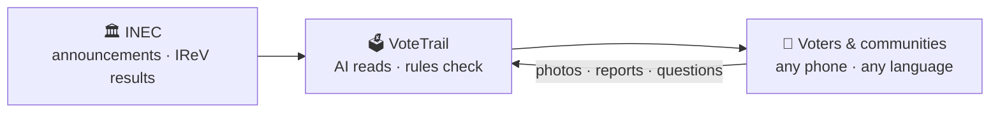

# VoteTrail

**Every vote, every voice.** A voice-first voter companion for Nigerian elections that works on any phone.

> INEC publishes the information. VoteTrail gets it to every voter, in their language, on any phone, and lets citizens check what was counted against what they saw.

Built for the KTech Fest 3.0 hackathon challenge *"Every Vote, Every Voice"* (`challenge.md`).

---

## The problem

INEC has moved much of the election online: CVR pre-registration and transfers, status and polling unit lookup, and result-sheet photos on IReV. But that information is **pull-only, English-only, smartphone-only, scattered, and never checked by citizens against what they saw.** That is how Amaka misses her polling unit's relocation, can't tell whether officials have arrived, doubts the final numbers, and can't check the rumours.

Evidence (sources in `docs/sources.md`):
- **Late openings.** In 2023, some units opened up to 5 hours late or not at all (EU EOM).
- **Missing results.** Only about 20% of presidential results were on IReV by noon the next day, and about 17% were still missing a month later.
- **Unannounced moves.** Voters weren't told in time about reallocated polling units (EU EOM).
- **What's at stake now.** The next general election is on **16 January 2027**, with **103M+** registered voters.

Full brief: [`docs/problem-brief.md`](docs/problem-brief.md).

## The solution

One weak link (the information-and-trust gap between INEC and citizens), followed across the whole voter journey:

| Step | What VoteTrail does |
|---|---|
| Register / transfer | Plain steps, the official CVR link only, fake-portal warning |
| Collect PVC | What to know, reminders |
| Polling unit | Lookup, **relocation alerts** by SMS and voice note, directions, accessibility notes |
| Election day | Live unit status from **official USSD check-ins** and crowd reports (two people must agree) |
| **Results (core)** | Photo of the wall **Form EC8A** → AI reads it → arithmetic and integrity rules → **compared with IReV** → Matches / Mismatch / Needs review → evidence pack |
| **Rumours (core)** | Report or check a claim → evidence from reports, verifiers and public sources → **rule-based verdict** in your language |
| Accessibility | Voice mode, large text, community relay |

**Channels:** web app (installable, works offline), **USSD**, **SMS**, **voice** (gpt-realtime), and a **community relay** (voice notes for leaders to announce).

### System sketch
See [`docs/system-sketch.md`](docs/system-sketch.md) (non-technical) and [`docs/architecture.md`](docs/architecture.md) (technical).



## How AI is used, and how it's constrained

**AI reads and explains; deterministic rules decide; VoteTrail never declares results.**

| AI task | Model | Guardrail |
|---|---|---|
| Read handwritten EC8A photos (citizen and IReV) | Azure OpenAI `gpt-5.6-terra-1`, strict JSON schema | Per-field confidence; unsure readings are confirmed only by the sheet's own arithmetic or words, otherwise left out of the comparison or sent to human review |
| Weigh evidence for rumours | Same, strict schema | Every quote must appear verbatim in its source or it's dropped; status comes from `apps/trust` rules only |
| Read official notices into affected polling units | Same, strict schema | Quotes verified; auto-applied only from INEC's own domains |
| Voice assistant (WebRTC) and voice-note understanding | Azure `gpt-realtime` | Answers only from tools and a sourced knowledge base; reads codes back; refuses "who won / who to vote for" |
| Voice notes for alerts | ElevenLabs TTS | Pre-written templates only (never free-form AI text for alerts) |
| Public-source evidence | Tavily search | ≤ 4 sources, cached per query per day |

**Trust rules** (`apps/trust`, pure Python, 100% branch coverage):
- **Forwards and repeats are never confirmation.** The same person, device or image, near-identical text, or a forward each count as one origin.
- **Mismatch needs two independent sources.** Two independent citizen origins must agree with each other and differ from IReV. Agents from rival parties agreeing is the strongest signal.
- **Corroborated needs time agreement.** It takes at least 2 independent origins whose observation times fall within the window. Publication time never counts as observation time.
- **Photos are checked for integrity.** In-app capture only, EXIF stripped, reuse across polling units rejected, and location and time window checked.

## Results we measured

| What | Result | Where |
|---|---|---|
| Unit + integration tests | **355 passing**, 90.8% coverage, trust rules 100% branch | `make check` |
| Browser tests (Playwright, 31) | Offline capture → reload → sync once; journey; USSD simulator; demo replay; axe on 20 pages; **live WebRTC voice tool loop** | `npx playwright test` |
| EC8A extraction (live, 32 synthetic sheets) | **98.4–98.6% field accuracy; 0 wrong sheets published without review** | `docs/reviews/eval/` |
| Rumour: 12–40 forwards of one message | Stays **Unconfirmed**, correct Pidgin verdict | `docs/reviews/eval/phase3_live.json` |
| Lighthouse (mobile) | Performance 90–99 · Accessibility 100 · Best practices 100 | `docs/reviews/lighthouse/` |
| Load (local, 200 concurrent uploads) | 200/200 accepted, p95 1.0 s, queue drained in 1 s, 0 failed jobs | `docs/reviews/eval/load_test.json` |

Phase reviews with scorecards: `docs/reviews/PHASE_1.md` … `PHASE_4.md`.

## Run it

Requirements: Python 3.12 (`uv`), Node 20+.

```bash
cp .env.example .env            # fill in keys (see below)
uv sync
make dev                        # migrate, seed, worker + server on http://127.0.0.1:8010
```

Open http://127.0.0.1:8010: the landing page plays Amaka's story in 3D as you scroll (saved from a real pipeline run). **Get started** sets up your profile in three taps; `/demo/` has the full replay. Rebuild the demo data with live AI:
```bash
uv run python manage.py build_demo_pack
```

Verifier dashboard:
```bash
uv run python manage.py create_verifier --username amina --phone 0803...
```
Then log in at `/dashboard/login/`. The SMS code appears in the outbox: `/simulator/` (demo) or a real SMS with Africa's Talking.

### Checks
```bash
make check          # ruff, migrations, tests + coverage, secret scan
make smoke          # production settings, Gunicorn + worker, real HTTP
npm run test:js     # offline queue + WAV encoder
npx playwright test # browser tests (LIVE=1 adds the real gpt-realtime test)
uv run python manage.py eval_extraction --live   # EC8A accuracy (costs tokens)
uv run python scripts/load_test.py 200
```

### Environment
See `.env.example`. Required in production: `SECRET_KEY`, `PHONE_HMAC_KEY`, `FIELD_ENCRYPTION_KEY`, `DATABASE_URL` (Postgres), `ALLOWED_HOSTS`, `CSRF_TRUSTED_ORIGINS`, and the Azure, ElevenLabs and Tavily keys. Optional: `NOTIFY_BACKEND=africastalking` with `AT_USERNAME` and `AT_API_KEY` for real SMS; `CHANNEL_WEBHOOK_TOKEN` for USSD/SMS webhooks; `SIMULATOR_ENABLED=false` with real users; `TRUSTED_PROXY_COUNT` (default 1 in prod).

### Deploy (ThalesOps)
`Dockerfile` + `scripts/start.sh` run migrations, Gunicorn and the job worker. If either process dies, the container exits so the platform restarts it. Attach a Postgres `DATABASE_URL`.

## Data and honesty
- **Polling units:** 24 real FCT polling units fetched from INEC's official CVR locator (`fixtures/geo/fct_sample.json`). Coordinates are approximate.
- **Mock data:** IReV sheets, parties (PA–PD, deliberately fictional and non-partisan), the election and the relocation are **demo data**, labelled in the UI. IReV has no public API; `PublicIrevSource` documents the path to official data.
- **Privacy (NDPA 2023):** no VINs stored. Phone numbers are stored as an HMAC (lookup) plus encrypted (sending). There's an append-only audit log and delete-my-data.

## Roadmap
1. Public INEC data adapters (IReV images, announcements) within INEC's terms.
2. CSO verifier network (e.g. Yiaga Africa, CDD, Dubawa).
3. Official INEC data feed; telco zero-rated USSD/SMS.
4. Native-speaker review of the Pidgin, Hausa, Yoruba and Igbo translations; Hausa, Yoruba and Igbo voice notes once a TTS voice exists; Nigerian language models (e.g. N-ATLAS).

## Credits
**Libraries:** Django 5.2, django-environ, WhiteNoise, Gunicorn, psycopg, cryptography, Pillow, ImageHash, httpx, OpenAI Python SDK, websockets, pytest, pytest-django, pytest-cov, Hypothesis, Ruff, Playwright 1.63, @axe-core/playwright, Lighthouse.
**APIs and services:** Azure OpenAI (`gpt-5.6-terra-1`, `gpt-realtime-2.1`), ElevenLabs TTS, Tavily Search, Africa's Talking (USSD/SMS spec; sandbox-ready), Google Fonts.
**Data:** INEC CVR polling unit locator (FCT sample); public reporting listed in `docs/sources.md`.
**Fonts:** Instrument Serif, Manrope, JetBrains Mono, Caveat (Google Fonts, OFL); Caveat and Kalam (OFL, `fixtures/fonts/`, for synthetic sheets).
**Design references:** layout inspired by hiwaar.life and isometric motion work found on designeer.xyz (no code or assets copied); 3D is plain CSS.
**Ideas:** the evidence-rules pattern is adapted (rewritten) from the team's earlier prototype *Amara*.

## AI coding assistant declaration
This project was built with **Claude Code** (Anthropic) as an AI coding assistant: planning, code, tests and docs, under the team's direction and review. Runtime AI features use Azure OpenAI, ElevenLabs and Tavily as listed above.
