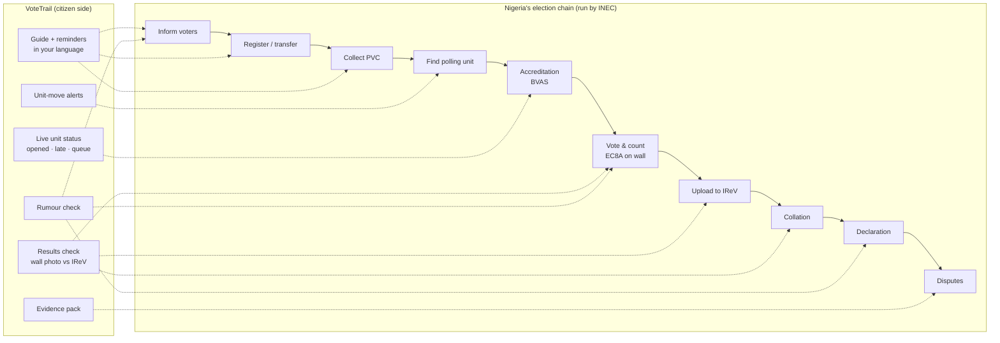
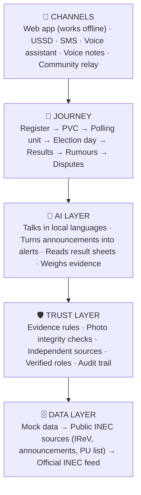
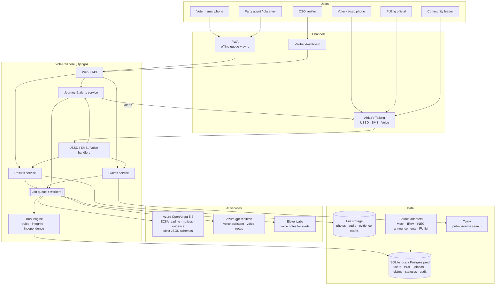
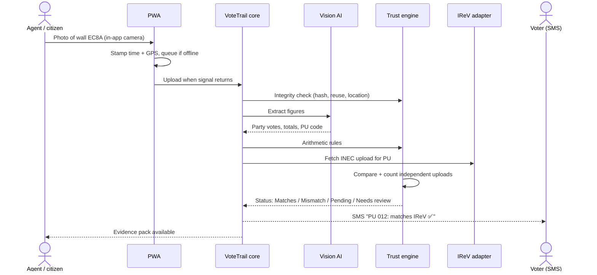
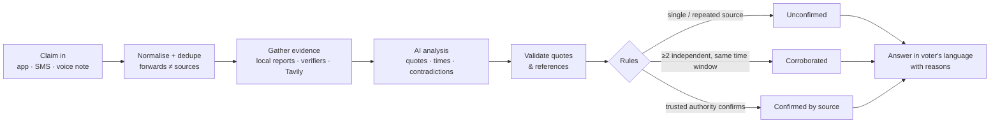
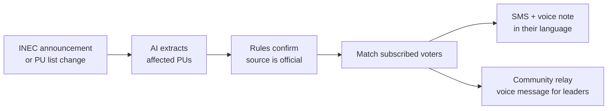

# Technical architecture: VoteTrail

Four views, from simple to technical:
1. **Big picture:** where VoteTrail fits in the election chain (non-technical)
2. **How it works:** the 5 layers (anyone)
3. **Architecture:** components and services (technical)
4. **Key flows:** results check, rumour check, unit-move alert

---

## View 1 — The big picture (non-technical)

The election chain runs left to right. VoteTrail plugs in at every stage where citizens need information or trust.

**Plain words:** INEC runs the election. VoteTrail sits beside it, telling voters what changed and letting them check what happened. It never replaces INEC and never declares results.

---

## View 2 — How it works: 5 layers

| Layer | In plain words |
|---|---|
| Channels | However you reach us: smartphone, basic phone, your voice, or through your community leader |
| Journey | We walk you through every step of voting |
| AI | Understands your language, reads photos and announcements |
| Trust | **AI suggests, rules decide.** Nothing is "confirmed" without independent evidence |
| Data | Starts on public data; plugs into INEC directly when allowed |

---

## View 3 — Architecture (technical)

**Design principles**
- **Rules first, AI second.** AI extracts and explains; the trust engine decides status.
- **Async by default.** Uploads and AI calls go through a queue, so spikes don't crash the app.
- **Offline-first.** The PWA queues uploads; USSD/SMS need only basic GSM.
- **Swappable data sources.** Adapters let us move from mock to public to official INEC data with no code change.
- **Privacy by design.** No VIN stored; phone numbers kept as a keyed hash (lookup) plus encrypted (sending); append-only audit log; delete-my-data (NDPA 2023).
- **Every language, every channel.** English, Pidgin, Hausa, Yoruba and Igbo across the app (Django i18n), USSD, SMS and verdicts, written in plain letters so they fit basic-phone SMS.

---

## View 4 — Key flows

### 4a. Results check (core)

### 4b. Rumour check (Amara pattern)

### 4c. Unit-move alert

---

## Trust rules (summary)

| Status | Rule |
|---|---|
| **Pending** | Not enough evidence yet |
| **Unconfirmed** | Single source, repeated forwards, or conflicting evidence |
| **Corroborated** | ≥2 independent sources (different verified numbers and devices) in the same time window, no unresolved conflict; cross-party agreement weighs most |
| **Confirmed by [source]** | A configured authority (e.g. INEC, police) explicitly confirms it |
| **Matches IReV** | Citizen figures = IReV figures, arithmetic valid |
| **Mismatch** | Citizen figures ≠ IReV, from ≥2 independent uploads → flagged to verifiers |
