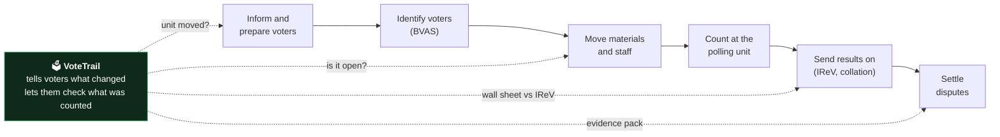
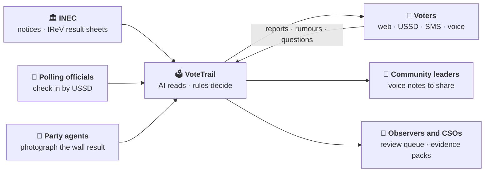
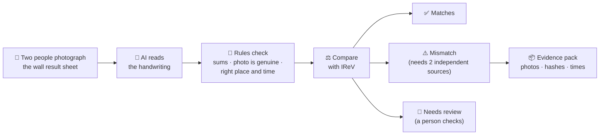

# System sketch: where VoteTrail fits

## 1 · The bigger picture: Nigeria's election chain
The challenge describes the election as a chain. VoteTrail strengthens one link, **information and trust between INEC and voters**, and that link runs alongside every other step.

*VoteTrail runs no part of the election. It works beside INEC's own steps.*

## 2 · Who does what

## 3 · The core feature: checking a result

**In one line:** INEC runs the election. VoteTrail **tells** every voter what changed and **lets them check** what was counted, on any phone and in their language. *AI reads, rules decide, and only INEC declares results.*

Technical detail: [`architecture.md`](architecture.md).
