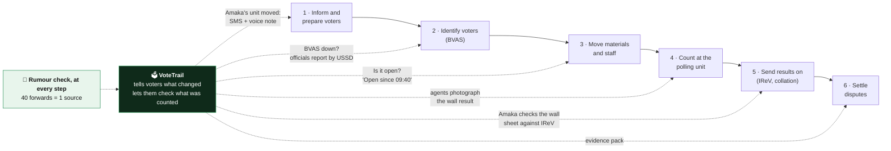
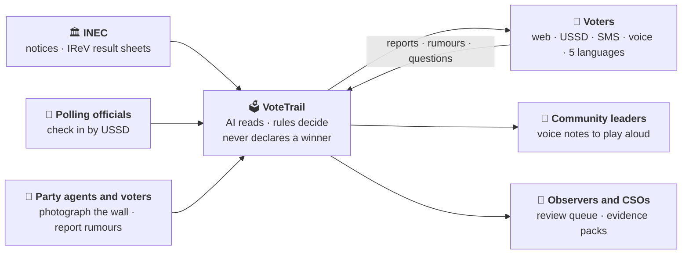
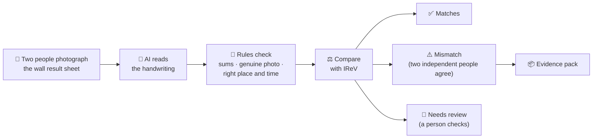
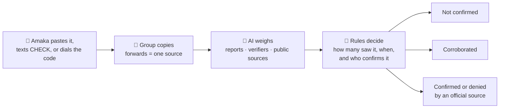

# System sketch: where VoteTrail fits
*Also on page 3 of the [problem brief PDF](problem-brief.pdf).*

## 1 · The bigger picture: Nigeria's election chain
INEC runs every step. VoteTrail runs none of them; it works beside them, strengthening one link: **information and trust between INEC and voters.**

## 2 · Who does what: information in, trust out

## 3 · The two core checks
**How a result is checked**

**How a rumour is checked**

**In one line:** INEC runs the election. VoteTrail **tells** every voter what changed and **lets them check** what was counted, on any phone and in their language. *AI reads, rules decide, and only INEC declares results.*

Technical detail: [`architecture.md`](architecture.md).
